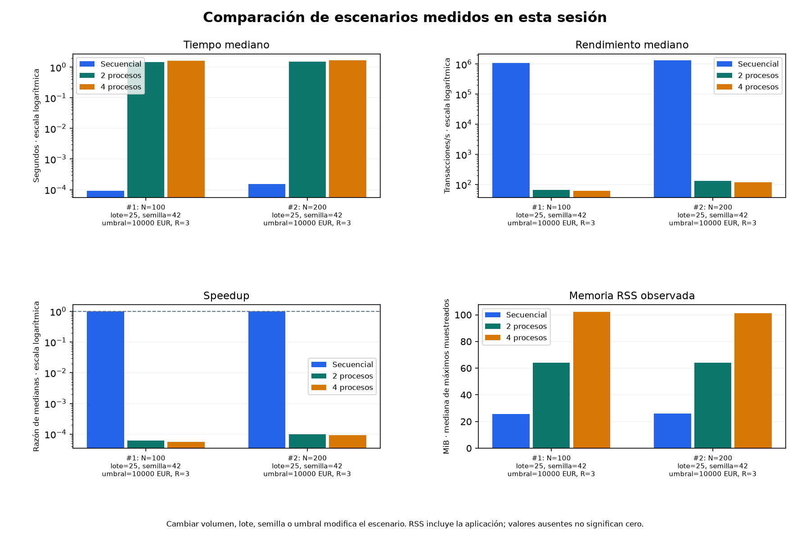

# Banking Data Processing Optimizer

**Python · Multiprocessing · Análisis de datos · Benchmarks reproducibles**

Herramienta de escritorio para comparar el procesamiento secuencial de transacciones bancarias sintéticas con dos y cuatro trabajadores. Mide tiempo, rendimiento y memoria observada, y comprueba que todas las estrategias produzcan exactamente los mismos resultados.

El objetivo es comprender cuándo compensa el paralelismo y cuánto cuestan la creación de procesos, la comunicación y la coordinación. No se presupone que más procesos sean más rápidos.

## Qué hace

- Genera transacciones ficticias reproducibles mediante una semilla configurable.
- Clasifica importes positivos en EUR según un umbral inclusivo: por defecto, **10.000 EUR o más**.
- Cuenta operaciones por categoría y suma sus importes, usando céntimos enteros.
- Compara ejecución secuencial, dos trabajadores y cuatro trabajadores, con lotes y repeticiones configurables.
- Verifica todas las clasificaciones, su orden, recuentos e importe total antes de aceptar la comparación.
- Presenta tiempos, transacciones por segundo, speedup, mejora temporal y memoria RSS observada.
- Exporta CSV y gráficos PNG con nombres únicos desde la interfaz.

Los datos son sintéticos. Las reglas son un simulador educativo y no constituyen un sistema real de detección de blanqueo de capitales ni un modelo de actividad bancaria real.

## Instalación y ejecución en Windows

Desarrollado con **Python 3.13 y Tkinter** en Windows 11 de 64 bits. No necesita GPU, servicios cloud ni bases de datos.

Clona el repositorio y prepara el entorno desde PowerShell:

```powershell
git clone https://github.com/MiguelPoza73/banking-data-processing-optimizer.git
cd banking-data-processing-optimizer
python -m venv .venv
.\.venv\Scripts\python.exe -m pip install -r requirements-lock.txt
.\.venv\Scripts\python.exe src/main.py
```

En Visual Studio Code, abre esta carpeta y selecciona `.venv\Scripts\python.exe` como intérprete. Tras instalar las dependencias también puedes hacer doble clic en **ejecutar.cmd**.

El comando `python src/main.py` utiliza automáticamente el entorno local si se inicia desde Python global y existe `.venv`. Si ya tienes otro entorno virtual activo, se respeta tu selección. No se instalan paquetes automáticamente.

Si falta Tkinter, revisa el componente Tcl/Tk de la instalación de Python; no se instala con `pip`. `requirements-lock.txt` fija las versiones usadas en las mediciones incluidas. `requirements.txt` declara rangos compatibles.

## Primer uso

1. Empieza con **100 transacciones**, **semilla 42**, **umbral 10000 EUR**, **3 repeticiones** y **lote 25**.
2. Pulsa **Generar y procesar** para ver las transacciones y el resumen bancario.
3. Pulsa **Comparar 1 / 2 / 4** para ejecutar las tres estrategias sobre los mismos datos.
4. Espera a que termine. La memoria está activada por defecto y añade una ronda independiente; puedes desmarcarla para terminar antes.
5. Consulta los resultados, pulsa **Ver gráficos** o **Exportar benchmark CSV**. Los gráficos se guardan desde su ventana mediante **Guardar gráficos PNG**.

**Medir secuencial** mantiene disponible el benchmark directo sin lotes, separado de la comparación entre estrategias. El resumen procesa todas las operaciones; la tabla muestra como máximo las primeras 100.

| Parámetro | Significado |
|---|---|
| Transacciones | Cantidad de operaciones ficticias. Límite inicial de 10.000 para evitar aumentos accidentales de carga. |
| Semilla | Permite repetir los mismos datos con el mismo código y versión de Python. |
| Umbral | Límite inclusivo en EUR; admite coma o punto decimal, sin separadores de miles. |
| Repeticiones | Veces que se procesa el mismo conjunto. No se generan datos nuevos ni se acumulan sus importes entre ejecuciones. |
| Lote | Grupo de transacciones enviado como una tarea; con 100 operaciones y lote 25 hay cuatro tareas. |

Con tres repeticiones hay nueve mediciones de tiempo: tres por estrategia. Si se mide memoria, se añaden otras nueve ejecuciones. La ventana permanece disponible, pero no permite ejecutar otra comparación ni cerrarse hasta finalizar.

Los datos y las últimas seis comparaciones se mantienen en RAM. Los CSV y PNG solo se guardan cuando lo solicitas. Tras completar dos comparaciones, **Comparar escenarios** permite contrastar volúmenes o lotes medidos manualmente.

## Cómo se mide

La generación de datos queda fuera del cronómetro. La comparación utiliza la misma función, las mismas entradas y los mismos límites de lote en las tres estrategias, incluida la secuencial.

Se usa `time.perf_counter()`. La medición incluye particionado, clasificación y agregación. En paralelo incluye también crear el Pool con `spawn`, iniciar intérpretes, serializar y transferir objetos, recoger resultados y cerrar trabajadores. Se crea un Pool nuevo en cada medición.

La validación de equivalencia, el cálculo de métricas, la actualización de la interfaz y la exportación quedan fuera del intervalo medido. Si una salida difiere o la ejecución falla, se invalida toda la comparación. El orden de ejecución rota entre repeticiones para reducir el efecto de medir siempre una estrategia primero; la presentación y el CSV se ordenan como secuencial, 2 y 4 procesos.

| Métrica | Cálculo e interpretación |
|---|---|
| Throughput | Transacciones / segundos de cada ejecución. |
| Mediana temporal | Valor central de los tiempos al ordenarlos. |
| Speedup | Mediana secuencial / mediana evaluada. Mayor que 1 significa más rápido; menor que 1, más lento. |
| Mejora temporal (%) | 100 × (mediana secuencial − mediana evaluada) / mediana secuencial. Un valor negativo indica empeoramiento. |
| Memoria RSS observada | Mediana de los máximos muestreados de la suma RSS del proceso principal y sus descendientes, en una ronda separada. |

La memoria se consulta con `psutil` cada aproximadamente 10 ms, además de lecturas anterior y posterior. **Incluye la aplicación, no es memoria exclusiva del algoritmo ni un pico exacto**: puede perder picos breves y contar páginas compartidas varias veces. Con 100 operaciones, el procesamiento secuencial puede terminar entre dos muestras. El detalle y las limitaciones están en [la metodología](docs/metodologia.md).

## Resultados experimentales incluidos

Mediciones reales por línea de comandos, con semilla 42, umbral de 10.000 EUR, lote 25 y tres repeticiones por estrategia. Tiempo y memoria corresponden a rondas separadas. Todas las salidas coincidieron con la referencia.

| Transacciones | Estrategia | Mediana de tiempo (s) | Mediana RSS observada (MiB) |
|---:|---|---:|---:|
| 100 | Secuencial por lotes | 0,000091700 | 25,65 |
| 100 | 2 trabajadores | 1,484123700 | 64,05 |
| 100 | 4 trabajadores | 1,617703900 | 102,33 |
| 200 | Secuencial por lotes | 0,000152100 | 25,89 |
| 200 | 2 trabajadores | 1,523157300 | 64,23 |
| 200 | 4 trabajadores | 1,653311400 | 101,05 |

Entorno de desarrollo: AMD Ryzen 3 3250U, 8 GB de RAM instalada (5,94 GB utilizables), Windows 11 Pro x64 y Python 3.13. Las dependencias exactas están en `requirements-lock.txt`. Los tiempos describen esas ejecuciones, no una garantía de rendimiento.



Las escalas de tiempo, throughput y speedup son logarítmicas para representar diferencias de varios órdenes de magnitud. Los datos originales de esta fase están en [100 transacciones](results/phase5_100_transactions.csv) y [200 transacciones](results/phase5_200_transactions.csv).

**Conclusión observada:** el secuencial fue más rápido en ambos escenarios pequeños. El coste de iniciar y coordinar trabajadores resulta grande en relación con una regla de comparación tan sencilla. Todavía no se ha identificado un volumen donde el paralelismo compense sus costes; estos resultados no se extrapolan a cargas mayores ni reglas más costosas.

## CSV y gráficos

Un CSV contiene cifras, no gráficos. Los gráficos se ven en la aplicación y se exportan como PNG; puedes insertarlos después en Excel o en un informe.

El CSV utiliza UTF-8 con BOM, `;` como separador y coma decimal para Excel en español. Si aparecen `########`, amplía la columna y revisa que su formato sea General o Número.

El comparativo conserva `procesos` como primera columna, con repeticiones agrupadas por estrategia. Añade las métricas de esta fase sin exportar las transacciones individuales. El speedup y la mejora corresponden a medianas y se repiten por estrategia; la memoria de cada fila procede de la ronda adicional. Si no se mide memoria, la celda queda vacía.

## Arquitectura

```text
src/
├── main.py            # Arranque, entorno virtual y ejecución por terminal
├── gui.py             # Ventana, parámetros y presentación
├── data_generator.py  # Datos sintéticos reproducibles
├── processing.py      # Regla y agregación compartidas
├── parallel.py        # Lotes y Pool de trabajadores
├── benchmark.py       # Mediciones, equivalencia, métricas y CSV
├── memory_monitor.py  # Muestreo RSS separado de los tiempos
└── reporting.py       # Gráficos de escenarios medidos y PNG
```

La interfaz utiliza un hilo de coordinación y una cola; los cálculos paralelos utilizan procesos independientes. Tkinter se actualiza exclusivamente desde su hilo principal. Las funciones de trabajo son importables y el arranque está protegido para Windows.

`psutil` se incorpora para consultar también los trabajadores. Matplotlib se utiliza para los gráficos; su dependencia NumPy no participa en la generación ni en el motor de procesamiento.

## Ejecución sin interfaz

```powershell
.\.venv\Scripts\python.exe src/main.py --compare --transactions 100 --repetitions 3 --batch-size 25 --csv results/mi_comparacion.csv --png results/mi_comparacion.png
```

`--no-memory` omite la ronda de memoria. También existen `--seed` y `--threshold-cents`. Las rutas explícitas del terminal pueden sobrescribirse; la interfaz propone nombres únicos. Consulta todas las opciones con `python src/main.py --help`.

## Alcance y limitaciones

- No incluye una suite de tests automatizados. Sí comprueba obligatoriamente la equivalencia de los resultados completos entre estrategias durante cada comparación.
- La regla actual es deliberadamente sencilla; no simula el coste de un sistema analítico bancario completo.
- No hay barridos automáticos de carga ni aumento automático del volumen. Se recomienda cambiar una variable cada vez y empezar con cantidades pequeñas.
- La memoria de la interfaz y del CLI tiene bases diferentes. Abrir gráficos carga bibliotecas y puede alterar la base de mediciones posteriores.
- Las mediciones históricas sin lotes no son directamente comparables con el secuencial por lotes. Los CSV antiguos se conservan identificados en `results/`.

Para profundizar en las decisiones, la validación, los costes del paralelismo y las limitaciones del muestreo, consulta [Metodología y guía detallada](docs/metodologia.md).
